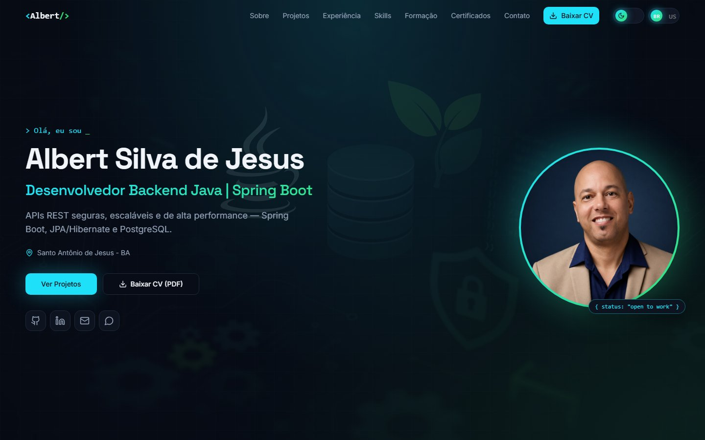
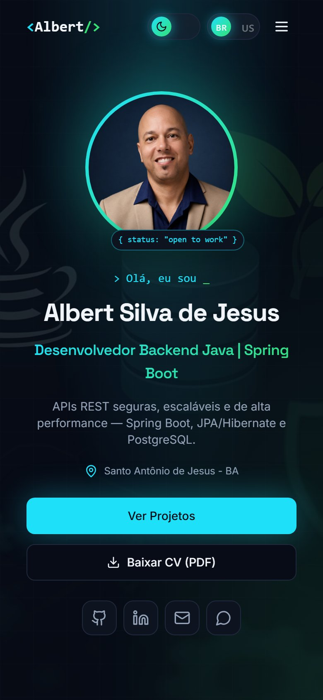
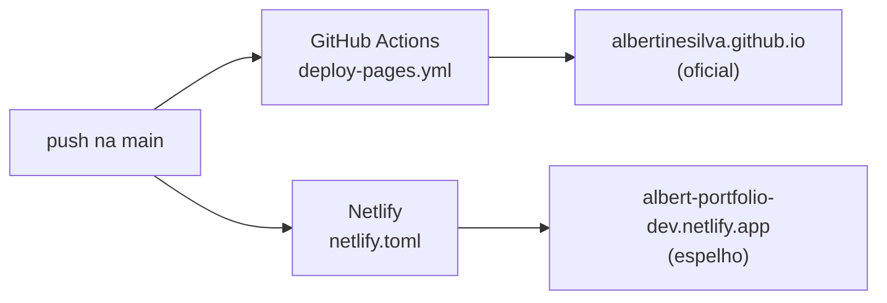

<h1 align="center">💼 Portfólio – Albert Silva de Jesus</h1>

<p align="center">
Landing page pessoal de <strong>Albert Silva de Jesus</strong>, desenvolvedor <strong>Backend Java | Spring Boot</strong>: projetos, experiência, skills, formação e contato em uma única página, em português e inglês.
</p>

<p align="center">
🌐 <a href="https://albertinesilva.github.io/"><strong>albertinesilva.github.io</strong></a> (site oficial) · 🔁 <a href="https://albert-portfolio-dev.netlify.app/">albert-portfolio-dev.netlify.app</a> (espelho)
</p>

<p align="center">

<a href="https://github.com/Albertinesilva/Albertinesilva.github.io/actions/workflows/deploy-pages.yml"></a>


</p>

<p align="center">
  
  &nbsp;
  
</p>

---

## 📑 Sumário

| Seção | Conteúdo |
| --- | --- |
| [🎯 Objetivo](#-objetivo) | Para quem é a página e o que ela mostra |
| [🧭 Seções da página](#-seções-da-página) | O que aparece em cada parte da landing page |
| [✨ Funcionalidades](#-funcionalidades) | O que a página faz |
| [🛠️ Stack](#️-stack) | Tecnologias e versões |
| [📂 Estrutura de pastas](#-estrutura-de-pastas) | Onde fica cada parte do código |
| [🚀 Como rodar localmente](#-como-rodar-localmente) | Pré-requisitos e comandos |
| [✏️ Como editar o conteúdo](#️-como-editar-o-conteúdo) | Textos, projetos, traduções e currículo |
| [☁️ Deploy](#️-deploy) | GitHub Pages e Netlify |
| [📬 Contato](#-contato) | LinkedIn, GitHub e e-mail |

---

## 🎯 Objetivo

Apresentar, em poucos segundos, o perfil de um **desenvolvedor Backend Java com Spring Boot** para recrutadores e tech leads: quem eu sou, o que já construí (com links para o código e, quando existe, para a versão publicada) e como falar comigo.

O foco é **backend**: Java, Spring Boot, Spring Security (OAuth2/JWT), JPA/Hibernate, PostgreSQL e testes automatizados. O conhecimento de frontend aparece como complemento.

---

## 🧭 Seções da página

| # | Seção | O que mostra |
| --- | --- | --- |
| — | **Início** | Nome, cargo, localização, botões "Ver Projetos" e "Baixar CV" e links para GitHub, LinkedIn, e-mail e WhatsApp |
| 01 | **Sobre** | Apresentação, objetivo profissional e quatro destaques (anos de projetos reais, residência, testes automatizados e formação) |
| 02 | **Projetos** | Cards com descrição, tecnologias, link do código e, quando existe, link da demo. Em destaque, o **ASJCatalog** (backend e frontend) |
| 03 | **Experiência** | Residência de Software TIC18 (CEPEDI), estágio na SMTT de Santo Antônio de Jesus e projeto na Incubadora INETI |
| 04 | **Skills** | Tecnologias por categoria: backend, segurança, banco de dados, testes, ferramentas, IDEs, frontend, práticas e outras linguagens |
| 05 | **Formação** | Tecnólogo em Análise e Desenvolvimento de Sistemas (IFBA) e TCC |
| 06 | **Certificados & Idiomas** | Cursos com carga horária e nível de idiomas |
| 07 | **Contato** | Links diretos, formulários de e-mail e WhatsApp e mapa da cidade |

---

## ✨ Funcionalidades

- 🇧🇷🇺🇸 **Português e inglês**: botão no menu troca o idioma de toda a página; a escolha fica salva no navegador.
- 🌗 **Tema escuro (padrão) e claro**, com a preferência salva no navegador.
- 📄 **Download do currículo** em PDF, pelo menu e pelo início da página.
- 🗂️ **Projetos com links separados** para o código ("Ver código") e para a versão publicada ("Ver demo"), quando ela existe.
- ✉️ **Formulário de e-mail**: valida os campos e abre o aplicativo de e-mail do visitante com a mensagem preenchida.
- 💬 **Formulário de WhatsApp**: valida os campos, tem seletor de país com código de discagem (lista da API [REST Countries](https://restcountries.com/)) e abre a conversa com a mensagem pronta.
- 🗺️ **Mapa da cidade** com Leaflet e OpenStreetMap.
- 📱 **Layout responsivo**, com menu fixo no topo e menu recolhível no celular.
- 🔗 **Navegação por âncoras**: cada item do menu leva à sua seção.

---

## 🛠️ Stack

| Tecnologia | Versão | Uso no projeto |
| --- | --- | --- |
| **React** | 18.3 | Interface (SPA) |
| **TypeScript** | 5.8 | Tipagem do código |
| **Vite** | 5.4 | Servidor de desenvolvimento e build (com o plugin React SWC) |
| **Tailwind CSS** | 3.4 | Estilos, tema escuro/claro e responsividade |
| **shadcn/ui** (Radix UI) | — | Componentes de interface (botões, campos, popover, toasts) |
| **lucide-react** e **Devicon** | — | Ícones da interface e das tecnologias |
| **Zod** | 3 | Validação dos formulários de contato |
| **Leaflet** | 1.9 | Mapa da seção Contato |
| **React Router** | 6 | Rota da página e página 404 |
| **Vitest** + Testing Library | 3 | Testes automatizados |
| **ESLint** + typescript-eslint | 9 | Análise estática do código |

---

## 📂 Estrutura de pastas

```text
├── .github/workflows/deploy-pages.yml   # build e deploy no GitHub Pages
├── netlify.toml                         # build e deploy na Netlify
├── index.html                           # título, descrição e meta tags de compartilhamento
├── public/                              # arquivos copiados sem alteração (currículo, favicon, robots.txt)
├── docs/images/                         # capturas usadas neste README
└── src/
    ├── data/
    │   ├── portfolio.ts                 # conteúdo em português (perfil, sobre, projetos, experiência, skills...)
    │   └── portfolio-en.ts              # traduções do conteúdo para o inglês
    ├── hooks/
    │   ├── use-language.tsx             # idioma e textos da interface (menus, botões, títulos)
    │   └── use-theme.tsx                # tema escuro/claro
    ├── components/
    │   ├── landing/                     # um componente por seção (Hero, About, Projects, Experience...)
    │   └── ui/                          # componentes do shadcn/ui
    ├── pages/                           # Index (landing page) e NotFound (404)
    ├── assets/                          # foto de perfil e imagem de fundo
    └── index.css                        # cores do tema e estilos globais
```

---

## 🚀 Como rodar localmente

**Pré-requisitos:** [Node.js](https://nodejs.org/) 20 (a versão usada no deploy) e npm.

```bash
git clone https://github.com/Albertinesilva/Albertinesilva.github.io.git
cd Albertinesilva.github.io
npm install
npm run dev
```

A página abre em `http://localhost:8080`.

| Comando | O que faz |
| --- | --- |
| `npm run dev` | Sobe o servidor de desenvolvimento com recarregamento automático |
| `npm run build` | Gera a versão de produção na pasta `dist/` |
| `npm run preview` | Serve localmente o conteúdo de `dist/` para conferir o build |
| `npm run test` | Roda os testes uma vez (`npm run test:watch` fica observando as mudanças) |
| `npm run lint` | Analisa o código com o ESLint |

> [!TIP]
> Antes de enviar uma mudança, rode `npm run lint`, `npm run test` e `npm run build`. Os dois deploys usam o mesmo `npm run build`.

---

## ✏️ Como editar o conteúdo

Quase todo o conteúdo fica em **arquivos de dados**, separados dos componentes. Toda mudança de texto deve ser feita **em português e em inglês**.

| Quero mudar... | Português | Inglês |
| --- | --- | --- |
| Nome, cargo, links, e-mail, telefone e caminho do CV | `src/data/portfolio.ts` → `profile` | `src/data/portfolio-en.ts` → `profileEn` (cargo, frase e localização) |
| Parágrafos e destaques do Sobre | `portfolio.ts` → `about` | `portfolio-en.ts` → `aboutEn` e chaves `about.highlight.*` em `use-language.tsx` |
| Experiências | `portfolio.ts` → `experiences` | `portfolio-en.ts` → `experiencesEn` (**mesma ordem**) |
| Projetos | `portfolio.ts` → `projects` | `portfolio-en.ts` → `projectsEn` (pelo **`id`** do projeto) |
| Skills | `portfolio.ts` → `skills` | Nome da categoria: chave `skills.cat.<categoria>` em `use-language.tsx` |
| Formação | `portfolio.ts` → `education` | Texto em `src/components/landing/Education.tsx` |
| Certificados e idiomas | `portfolio.ts` → `certificates` e `languages` | `portfolio-en.ts` → `certificatesEn` |
| Textos da interface (menus, botões, títulos, formulários) | `src/hooks/use-language.tsx` → `pt` | `src/hooks/use-language.tsx` → `en` |
| Currículo | Substituir `public/Albert-Silva-Curriculo.pdf` (ou mudar `profile.cvPath`) | — |
| Título da aba, descrição e preview de compartilhamento | `index.html` | — |

### Projetos e o campo `id`

Cada projeto tem um `id` único. A **ordem de exibição** é a da lista `projects`, e a tradução é encontrada pelo `id`, então reordenar os projetos não embaralha os textos em inglês.

```ts
// src/data/portfolio.ts
{
  id: "dsmovie",                       // liga o projeto à tradução em portfolio-en.ts
  title: "DSMovie — Full Stack Spring Boot + React",
  description: "...",
  stack: ["Java", "Spring Boot", "React"],
  github: "https://github.com/...",    // botão "Ver código"
  demo: "https://...",                 // opcional: botão "Ver demo"
  next: "...",                         // opcional: linha "Próximos passos"
  isPrivate: true,                     // opcional: repositório privado (sem link de código)
  featured: true,
}
```

```ts
// src/data/portfolio-en.ts
export const projectsEn = {
  dsmovie: { title: "DSMovie — Full Stack Spring Boot + React", description: "..." },
};
```

Uma **categoria nova de skills** precisa da chave `skills.cat.<nome>` (pt e en) em `use-language.tsx` e do ícone em `iconFor()`, em `src/components/landing/Skills.tsx`.

---

## ☁️ Deploy

O site é publicado em **dois lugares**, automaticamente, a cada push na branch `main`:



### GitHub Pages (oficial)

- O workflow [`.github/workflows/deploy-pages.yml`](.github/workflows/deploy-pages.yml) instala as dependências com `npm ci`, roda `npm run build`, copia o `index.html` para `404.html` e publica a pasta `dist/` com as actions oficiais (`configure-pages`, `upload-pages-artifact` e `deploy-pages`).
- O `404.html` faz o GitHub Pages entregar a aplicação em qualquer endereço, e o React Router mostra a página certa (ou a página 404 do próprio site).
- Em **Settings → Pages**, a fonte de publicação é **GitHub Actions**.
- O workflow também pode ser executado manualmente pela aba **Actions** (`workflow_dispatch`).

### Netlify (espelho)

- O [`netlify.toml`](netlify.toml) define o build (`npm run build`), a pasta publicada (`dist`) e o redirecionamento de SPA (`/*` → `/index.html`, status 200).
- A Netlify faz o build a partir da mesma `main`, de forma independente do GitHub Actions.

> [!NOTE]
> A tag `<link rel="canonical">` do `index.html` aponta para `https://albertinesilva.github.io/`, para os buscadores tratarem o GitHub Pages como o endereço oficial.

---

## 📬 Contato

**Albert Silva de Jesus**  
Desenvolvedor Backend Java | Spring Boot · Santo Antônio de Jesus - BA

[](https://www.linkedin.com/in/albert-backend-java-spring-boot/)
[](https://github.com/Albertinesilva)
[](mailto:albertinesilva.17@gmail.com)

📢 Sinta-se à vontade para explorar os projetos e entrar em contato!
